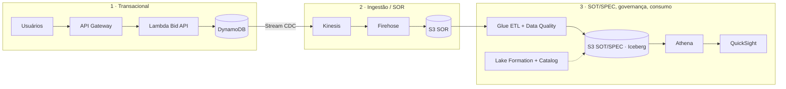

# Arquitetura AWS e decisões técnicas

Diagrama: [`arquitetura_leilao_aws.drawio`](arquitetura_leilao_aws.drawio).
Ele está dividido em três faixas, que são as três responsabilidades da solução.



## Por que esse desenho (e por que simples)

- **Poucos serviços, todos gerenciados/serverless.** Menos coisa para operar,
  escala automática e cobrança por uso. É um desenho fácil de aprovar em
  arquitetura e segurança.
- **Separação clara entre o transacional e o analítico.** O DynamoDB é a
  **base operacional** que decide o lance. O lake nunca decide
  nada: ele recebe, organiza e prova.
- **Pensado para um banco:** rastreabilidade de ponta a ponta (cada lance tem
  um id e uma sequência), dado pessoal pseudonimizado no lake, acesso
  governado por Lake Formation e conciliação automática entre as visões.
  Encaixa num modelo de **data mesh**: o domínio "Leilões" publica um
  **produto de dados** (a SOT/SPEC) com contrato, dono e qualidade.

## Camadas de dados: SOR → SOT → SPEC

| Camada | Significado | Neste projeto | Quem usa |
|---|---|---|---|
| **SOR** — System of Record | o dado **como veio da origem**, bruto e imutável; base para reprocessar e auditar | eventos de decisão vindos do CDC, com duplicados e fora de ordem | engenharia de dados, auditoria |
| **SOT** — Source of Truth | o dado **tratado e oficial**: esquema validado, deduplicado, ordenado, pseudonimizado; a versão única e confiável | uma linha por lance, em ordem de commit | todos os consumidores |
| **SPEC** — Specialized | visões **especializadas** para um uso ou área de negócio | resumo por leilão, motivos de rejeição | negócio, risco, antifraude, BI |

> Para quem conhece a arquitetura medalhão: SOR ≈ Bronze, SOT ≈ Silver,
> SPEC ≈ Gold. Aqui uso a nomenclatura SOR/SOT/SPEC.
>
> Atenção ao termo: o **DynamoDB é a base operacional** que decide o lance.
> A SOR é a **camada de dados** que guarda, sem alterações, o que essa
> origem publicou.

## Faixa 1 — Transacional: decidir sem race condition

O lance é aceito só quando o DynamoDB grava de forma **condicional e atômica**:

```text
TransactWriteItems:
  Put    LANCE#<lance_id>  Condition: attribute_not_exists(PK)          -> sem duplicado (idempotência)
  Update LEILAO#<id>       SET preco, vencedor, versao = versao + 1
                           Condition: versao = :versao_lida             -> sem race condition
                                      AND :agora < encerra_em           -> nada depois do fim
```

- Se a condição falha, quem perdeu a corrida **relê e é reavaliado**
  (controle otimista). Não existe janela entre conferir e gravar.
- **Ordem determinística:** vale a ordem dos commits (`sequencia` e `versao`
  gravadas pelo servidor), nunca o relógio do cliente. Em empate de valor,
  vence quem commitou primeiro.
- **Idempotência:** o cliente manda um `lance_id` (UUID); um retry recebe a
  mesma resposta.
- **Tempo real:** a resposta sai logo após uma única escrita, e o novo preço é
  enviado aos outros participantes via WebSocket.
- **Leilão muito disputado:** uma chave do DynamoDB suporta cerca de 1.000
  escritas/s. A Lambda recusa na hora quem está abaixo do preço atual (em
  cache) e só os candidatos plausíveis chegam à escrita condicional.

## Faixa 2 — Ingestão: SOR

- **DynamoDB Streams (CDC)** publica cada decisão gravada. Funciona como uma
  *outbox* nativa: se a gravação aconteceu, o evento existe. Não há
  *dual write*, e portanto não há evento perdido.
- **Kinesis → Firehose → S3 SOR**: dado bruto, imutável, particionado por
  data. É a fonte para reprocessar tudo, se necessário.
- **Premissa honesta:** a entrega é *at-least-once* e pode vir fora de ordem.
  A camada seguinte é desenhada para isso (a simulação injeta duplicados e
  embaralha os eventos de propósito).

## Faixa 3 — SOT, SPEC, governança e consumo

| Camada | O que garante | No código |
|---|---|---|
| **SOT** | contrato de esquema (registro inválido vai para quarentena), **dedup por `lance_id`**, **reordenação por `(leilao_id, sequencia)`**, **usuário pseudonimizado** (hash com sal) | `dados.construir_sot` |
| **SPEC** | preço final, vencedor, taxa de aceite, participantes únicos, motivos de rejeição | `dados.construir_spec` |
| **Data Quality** | unicidade, completude, sequência sem buracos, aceitos crescentes, **reconciliação SPEC × DynamoDB**, ausência de PII | `dados.checar_qualidade` (na AWS: Glue Data Quality) |

- **Formato:** Apache Iceberg/Parquet no S3, o que dá *upsert* (MERGE) para
  dedup idempotente, *time travel* para auditoria e consulta barata no Athena.
- **Governança:** Glue Data Catalog e Lake Formation (permissão por coluna; a
  chave de pseudonimização fica no Secrets Manager, fora do lake).
- **Consumo:** Athena (SQL) e QuickSight para negócio, risco e antifraude
  (por exemplo, padrões de lances de bots).
- **Observabilidade:** CloudWatch com latência do lance, taxa de conflito,
  atraso do stream e alarme quando uma regra de Data Quality falha.

## Falhas e como a solução se comporta

| Situação | Resultado |
|---|---|
| Dois lances iguais no mesmo milissegundo | um é aceito; o outro é reavaliado e rejeitado como `abaixo_do_minimo` |
| Cliente reenvia por timeout | mesma resposta; nenhuma decisão nova |
| Evento duplicado no stream | removido na SOT (dedup por `lance_id`) |
| Eventos fora de ordem | SOT reordena por `sequencia` |
| Registro corrompido | quarentena; o pipeline não para |
| Divergência entre lake e operacional | a regra de reconciliação falha e dispara um alarme |
| Lance depois do fim | a condição `agora < encerra_em` recusa, mesmo se o job de encerramento atrasar |

## Da POC para a AWS

| POC (Python) | AWS |
|---|---|
| `dominio.avaliar_lance` + `servico.ServicoDeLances` | Lambda Bid API |
| `RepositorioEmMemoria.gravar_decisao` | DynamoDB `TransactWriteItems` condicional |
| `repo.outbox` | DynamoDB Streams → Kinesis |
| `dados.entregar_como_kinesis` | Firehose → S3 SOR |
| `dados.construir_sot` / `construir_spec` | Glue ETL (Spark) em tabelas Iceberg |
| `dados.checar_qualidade` | Glue Data Quality (regras DQDL) + alarme |
| `dados.pseudonimizar` | Glue + chave no Secrets Manager, acesso via Lake Formation |

**Limitações:** a POC roda em um único processo e prova a **correção**, não a
capacidade da AWS. A latência de banco é simulada para provocar disputas
reais entre threads.
