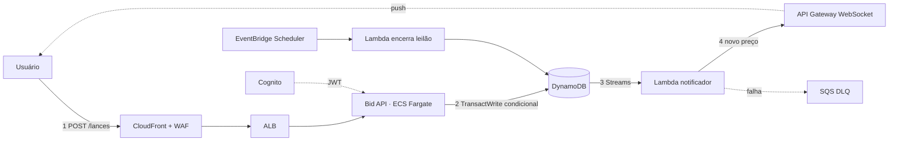

# Arquitetura AWS e decisões técnicas

Diagrama editável com ícones AWS: [`arquitetura_leilao_aws.drawio`](arquitetura_leilao_aws.drawio).



## 1. Requisitos (explícitos e implícitos)

| Requisito | Como é atendido |
|---|---|
| Centenas de milhares de lances em segundos | API stateless no Fargate com auto scaling; DynamoDB on-demand; WAF e rate limit barram abuso |
| Resposta em tempo real | caminho síncrono curto: validar → 1 escrita no DynamoDB → responder (~10 ms) |
| Todos veem o novo preço | DynamoDB Streams → Lambda → WebSocket, fora do caminho do lance |
| Ordem de chegada determinística | ordem dos commits no item do leilão (`versao`/`seq`), definida pelo servidor |
| Sem lance inválido por race condition | escrita condicional pela versão lida; quem perde a corrida é reavaliado |
| Sem lance duplicado | `Idempotency-Key` (UUID do cliente) gravada na mesma transação; reenvio recebe a mesma resposta |
| **Além do enunciado** | anti-sniping, incremento mínimo, encerramento por horário, rate limit, observabilidade, testes de carga |

## 2. Caminho do lance (síncrono)

1. **CloudFront + WAF**: TLS na borda, proteção contra bots e rate limit por IP.
2. **ALB → Bid API (ECS Fargate)**: containers stateless em várias AZs, com auto scaling por CPU e requisições. O usuário vem do JWT do Cognito, nunca do corpo.
3. **DynamoDB**: uma transação decide o lance:

```text
TransactWriteItems:
  Put    LANCE#<idempotency_key>  Condition: attribute_not_exists(pk)          -> sem duplicado
  Update LEILAO#<id>              SET preco, vencedor, versao = versao + 1, seq = seq + 1
                                  Condition: versao = :versao_lida             -> sem race condition
                                             AND :agora < encerra_em           -> nada depois do fim
```

Se a condição falha, a transação inteira é desfeita. A API distingue os dois casos:
- **a chave já existe** → é um reenvio: devolve a decisão original (`Idempotent-Replayed: true`);
- **a versão mudou** → outro lance ganhou: relê o leilão e reavalia (pode virar `409 abaixo_do_minimo`).

Código: [`leilao/servico.py`](../leilao/servico.py) (loop de reavaliação) e
[`leilao/repositorio_dynamodb.py`](../leilao/repositorio_dynamodb.py) (transação real).

### Por que controle otimista e não lock?

- Um lock distribuído (Redis, por exemplo) é mais um sistema para falhar, e o TTL pode expirar no meio da operação.
- Com a condição dentro do banco, **conferir e gravar são a mesma operação atômica**: não existe janela entre elas.
- O custo de um conflito é uma releitura, e conflitos só acontecem entre lances do mesmo leilão.

### Por que DynamoDB?

Latência baixa e previsível em qualquer escala, escrita condicional e transações
nativas, Streams para eventos e nenhum servidor para operar. Um Aurora com
`SELECT ... FOR UPDATE` também resolveria a correção, mas lock de linha sob
disputa alta degrada mais e o banco escala menos horizontalmente.

## 3. Tempo real e agendamento (assíncrono)

- **DynamoDB Streams → Lambda notificador → API Gateway WebSocket**: cada lance aceito vira um evento a partir do próprio commit (sem *dual write*), e todos os participantes recebem o novo preço.
- A notificação **não está no caminho do lance**. Se falhar, vai para a **SQS DLQ** após retries, e o lance continua válido. O cliente pode consultar `GET /leiloes/{id}` a qualquer momento.
- **EventBridge Scheduler → Lambda** encerra o leilão no horário. Mesmo que atrase, a condição `:agora < encerra_em` já impede lances depois do fim.
- Na POC, o tempo real é um **Server-Sent Events** (`/ao-vivo`) com fila por assinante; um cliente lento perde eventos intermediários, mas nunca trava o leilão.

## 4. Escala e o leilão "quente"

Um item raro concentra o tráfego em **uma única chave** do DynamoDB, que suporta
cerca de 1.000 escritas/s por partição. Mitigações, em camadas:

1. **Pré-filtro na API:** preço atual em cache (alimentado pelo Stream, TTL curto). Lances `< preço + incremento` são recusados com `409` sem tocar o banco. Num leilão disputado, a maioria fica abaixo do mínimo.
2. **A taxa de lances aceitos é naturalmente baixa:** cada um precisa superar o anterior.
3. **WAF + token bucket por usuário** (`429`) contra bots.
4. **Escala extrema:** um sequenciador por leilão (fila particionada por `leilao_id` com um único consumidor) elimina conflitos, mas a resposta passa a ser assíncrona. Fica como evolução, não como padrão.

## 5. Falhas

| Situação | Comportamento |
|---|---|
| Cliente sem resposta (timeout) | reenvia com a mesma `Idempotency-Key` e recebe a decisão original |
| Mesma chave com outro valor | `422 idempotency_key_reutilizada` |
| Container cai após o commit | a decisão já está gravada; o evento sai pelo Stream |
| Notificação falha | retries + DLQ; o lance não é afetado |
| Disputa excessiva | após N tentativas, `503`; reenviar com a mesma chave é seguro |
| Falha de AZ | Fargate e DynamoDB multi-AZ; Global Tables para DR, com escrita em uma única região para manter a ordem |

## 6. Segurança e operação

- Cognito (JWT) valida o usuário; WAF na borda; containers em subnets privadas.
- Criptografia com KMS em repouso; TLS em trânsito.
- **Métricas no CloudWatch:** latência p50/p95/p99 do lance, taxa de `409`, conflitos de versão por segundo, `429`, tamanho da DLQ. **X-Ray** para tracing ponta a ponta.
- Teste de carga antes de leilões grandes (o `simular.py --http` é a versão local).
- IaC com CDK ou Terraform e deploy blue/green no ECS (próximos passos).

## 7. Da POC para a AWS

| POC | AWS |
|---|---|
| `api.py` (http.server, sem dependências) | Bid API em container no ECS Fargate atrás do ALB |
| `X-Usuario-Id` | JWT do Cognito |
| `LimitadorDeTaxa` | WAF rate-based rules + throttling |
| `RepositorioEmMemoria` (lock por leilão + checagem de versão) | `RepositorioDynamoDB` (`TransactWriteItems` condicional) |
| `Notificador` + SSE `/ao-vivo` | DynamoDB Streams → Lambda → API Gateway WebSocket |
| `Dockerfile` | imagem no ECR |

**Limitações:** a POC roda em um processo, então os números de carga medem
a correção e a latência local, não a capacidade da AWS. O adaptador DynamoDB
não é exercitado pelos testes; o próximo passo é rodá-lo contra o DynamoDB Local.
